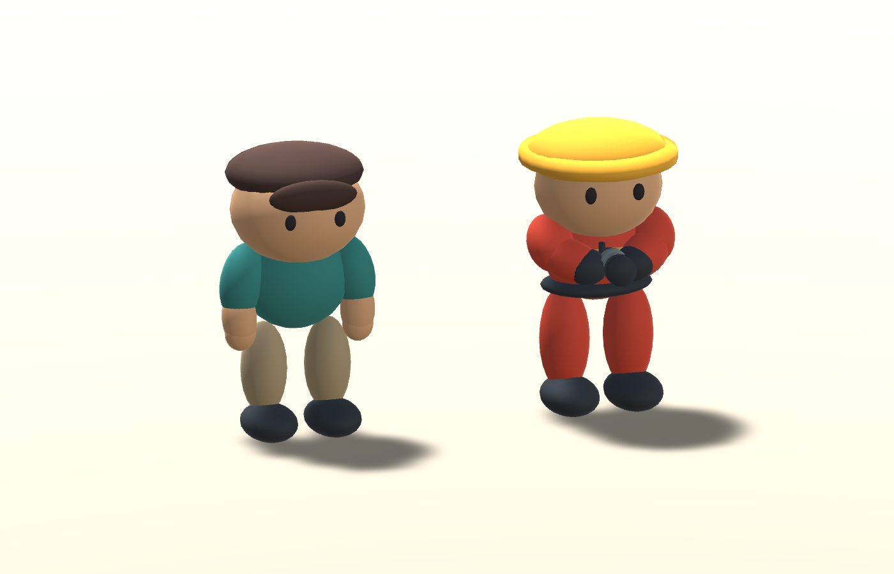
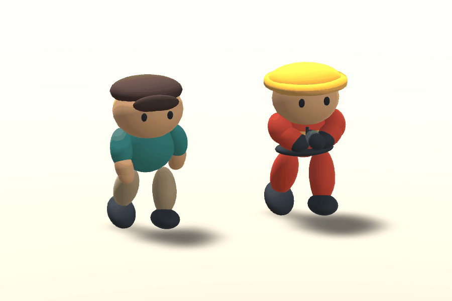
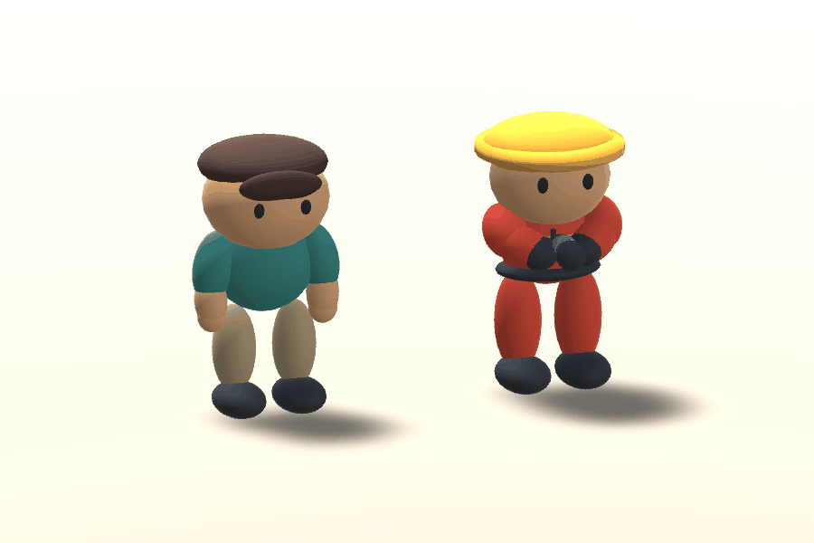

# 圓潤公仔角色與動畫 v0.2

日期：2026-10-05。遊戲仍為消防 Prototype v0.1；v0.2 是角色美術迭代，不是多人／完整遊戲版本。

此版已被使用者否決並於 2026-10-07 修訂。以下資料保留為歷史，不代表目前模型或驗證；最新實拍、缺陷原因與修正見 [v0.3 視覺迭代](CHARACTERS_v0.3_REVIEW.md)。

## 參考與範圍

本輪使用者附圖保存於 `Models/v0.2/reference.png`。以圖中的消防員與居民為人物比例／風格參考：圓鼓身體、大頭短肢、簡單眼睛與髮型、紅橘消防服／黃色帽／深色手套鞋。拿掉原方塊腿、徽章與髮型小零件。未重做圖中的精細住宅與家具，原簡化三房場景不變；不宣稱概念圖與 Unity 光照完全相同。

主代理看實際 Blender／Unity 渲染後，將第一輪珠狀分段腿改為連續跨膝加權網格，圓柱平帽手臂改為圓端形狀。此頁展示的都是實際 Mesh／骨架渲染，不是新生成的概念圖。







## 可編輯資產

- `ArtSource/Models/Firefighter.blend`、`Resident.blend`：人物 Mesh、18 骨架、頂點權重、Idle／Run Actions；沒有烘入攝影棚。
- `Assets/FireRescue/Art/Models/Firefighter.fbx`、`Resident.fbx`：Unity 消費的模型與嵌入動作。
- `Assets/FireRescue/Art/Prefabs/Firefighter.prefab`、`Resident.prefab`：含 Generic Animator、原平色材質、Skinned Mesh。
- `Assets/FireRescue/Art/Animations/Firefighter.controller`、`Resident.controller`：Idle／Run 與 Speed／CycleSpeed。
- `Runtime/Presentation/CharacterLocomotionAnimation.cs`：只依實際水平位移呈現動作，不改移動、噴射、油水、火焰或 NPC 尋路。

| 角色 | Blender 三角數 | Unity 匯入三角數 | 骨架 | 作者身高 |
| --- | ---: | ---: | ---: | ---: |
| 消防員 | 9116 | 9024 | 18 | 1.60m |
| 居民 | 8448 | 8448 | 18 | 1.60m |

Unity 的 skinned bounds 包含動畫包圍盒，不能直接拿 bounds 高度當靜態作者身高。角色 Collider 保持原 1.6m／radius .28，不依美術包圍盒重設。腿網格上下腿權重混合，其餘軀幹／裝備為簡單公仔單骨權重；沒有 Humanoid 重定向、指骨、臉骨或 IK。

## 動作與玩法接線

- Idle：30fps，0–60，共 2 秒，小幅呼吸／點頭。
- Run：30fps，0–24，共 .8 秒，交替抬腿／彎膝；居民擺臂，消防員維持雙手前持噴嘴。
- 動作原地循環，`applyRootMotion=false`；玩家與 NPC 的位置／轉向由原玩法控制，不從 Animation Event 改變任何遊戲狀態。
- 呈現元件 LateUpdate 取樣解決碰撞後的位移。移動時 Run、停下／撞牆 Idle；傳送／停用重置，玩家 4m/s、居民 2.15m/s 為播放速度基準。
- Animator 只用 Speed、CycleSpeed 兩個 float；.12 秒雙向過渡，門檻 .06／.04，不新增角色動畫大型框架。
- 住宅只替換兩個人物 Visual 並加入呈現元件。固定碰撞、地圖、鏡頭、來源、其他家具與玩法腳本保持原樣；不是重跑住宅生成器。

## 重建

```powershell
& 'C:\Program Files\Blender Foundation\Blender 5.1\blender.exe' --background --python 'ArtSource\Tools\build_characters.py'
```

上述入口呼叫新版 `build_rounded_characters.py`。Unity 選「消防 Prototype／更新圓潤角色與動畫（保留住宅）」，不要以全住宅重建來套用角色。此動作會更新兩個 Prefab／Controller 並保存住宅人物接線，請先退出 Play 並保存自己的修改。

實際預覽：選「消防 Prototype／擷取新版角色與動作預覽」，再用 bundled Python + Pillow 執行 `ArtSource/Tools/pack_character_previews.py` 包裝 GIF。PNG 逐幀來自 Unity Animator／Camera.Render，`forceMatrixRecalculationPerRender` 只用在臨時預覽以刷新同一 Editor update 內的多次姿態渲染，不是修改正式遊戲 Renderer。

## 本輪驗證

- Blender 實測作者身高、18 骨、所有 Mesh 有 Armature／權重，兩個 Actions 非空、逐幀 Root 穩定與循環端點一致；報告 `Models/v0.2/character-v2-report.json`。
- Unity 實際匯入／編譯／角色接線與前／斜／後視角預覽通過，exit 0。不是只做 C# 靜態審查。
- `CharacterAnimationValidation` 31 項 Play Mode 通過、exit 0：Generic Avatar、序列化參考速度、Controller、左腳 BakeMesh 真實變形／循環、實際玩家移動／停下／撞牆、傳送／停用、NPC 真實自主路線與救出後重新啟用待機。
- 原 `ResidentialPrototypeValidation` 40 項本輪重跑通過、exit 0：實際水箱接管→跨房拉管→清火／安撫→住戶到出口；油地、助燃、噴流牆阻擋、水推物件也保留。
- 玩法／Collider 序列化比較一致；57 個原玩法腳本／其他家具模型與 Prefab／ProjectSettings 檔案 hash 未變，兩組 FBX／Prefab GUID 保留。
- 持久證據在 `Docs/Validation/2026-10-05-character-v2`；日誌 `Logs/character-setup.log`、`character-animation.log`、`character-residential.log`。初次預覽的地板自陰影條紋、同幀 skin 快取造成的凍結姿態已修正，失敗預覽日誌仍保留，不拿渲染器快取問題修改玩法。
- 原 Unity Beta 的舊測試 `FindObjectsByType` obsolete warnings、背景授權 token 警告仍存在，但不阻止本輪編譯／測試；沒有新 runtime 例外。未改套件或清除 Console 隱藏問題。

未測 Windows Player build／多人或實體輸入手感。未製作獨立噴射／滑倒／受傷動作；消防員持管動畫屬簡化抱持，不是雙手 IK，少量手掌／噴嘴位置偏差仍可在美術下一輪微調。沒有重新細化家具／住宅。

技術參考：[Unity 原地動作與 Root Motion](https://docs.unity.com/en-us/engine/6000.5/manual/animation-section/animation-mecanim/avatar-creationand-setup/scripting-root-motion)、[Unity 多次渲染的骨架矩陣刷新](https://docs.unity3d.com/ja/6000.0/ScriptReference/SkinnedMeshRenderer-forceMatrixRecalculationPerRender.html)。
