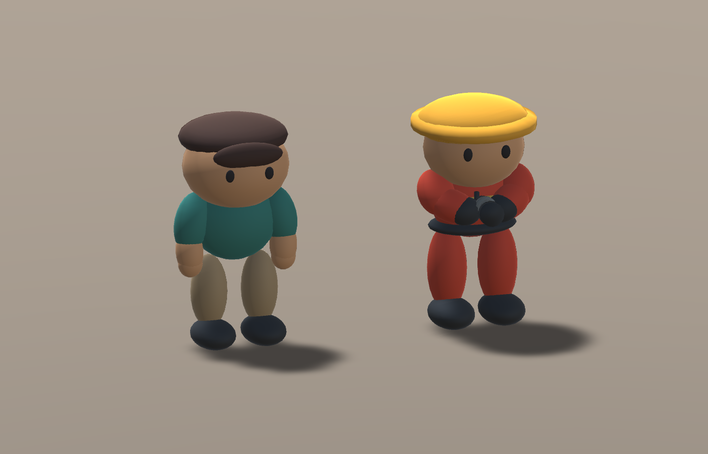
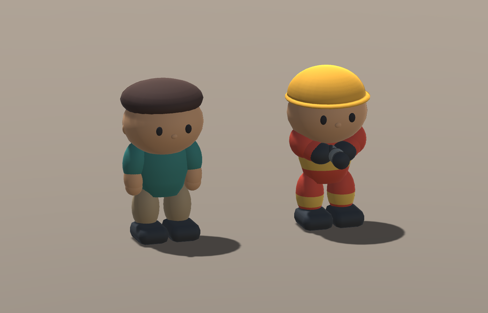
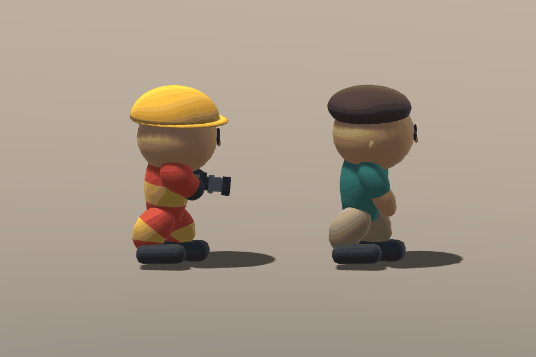
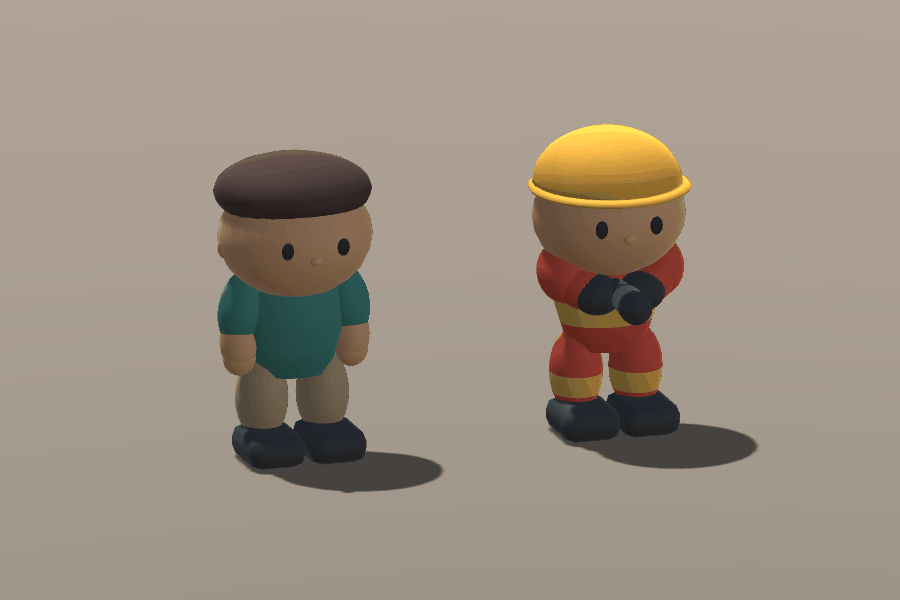
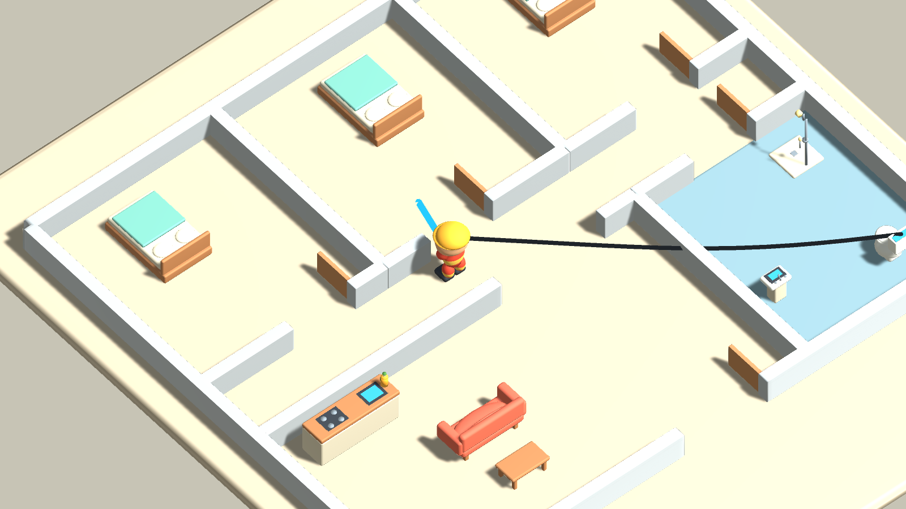

# 角色 v0.3 視覺迭代紀錄

日期：2026-10-07。只改善消防員／居民模型、骨架動作及持管視覺，不重建房屋或改消防規則。

## 為什麼否決上一版

主代理直接檢視 v0.2 Unity 正面、斜角和 Run 第 6 幀，而不是只讀生成報告。

- 上衣往下收成尖端，腿頂沒有足夠的盆骨覆蓋，形成明顯透光空隙。骨頭的父子關節位置一致，不代表 Mesh 沒有破綻。
- 腿佔比過長、橢圓零件彼此獨立，形狀語言仍像拼裝積木，不是參考圖的大頭短肢公仔。
- 消防帽是低薄帽冠加厚帽沿，讀成圓盤；反光帶埋在衣服裡，正面幾乎看不到。
- 居民髮帽與瀏海是兩塊相疊扁橢圓，沒有沿頭型包覆的髮際線。
- 原 Run 關鍵姿態讀成漂浮小踏步，缺乏明確接觸節奏（部分漂浮感也來自預覽陰影，見第五輪診斷）；噴嘴留在固定 Actor 插槽，沒有跟隨胸部呼吸和跑步。

參考仍為使用者原圖 `Models/v0.2/reference.png`，沒有以新概念圖代替實際模型。

## 第一輪：仍不通過

實際 Blender 圖確認帽冠、盆骨覆蓋和髮帽有改善，但新的腰帶／胸帶環形幾何在深度方向比身體大，讀成浮在身體外的救生圈；腿的可見長度仍過長。住戶盆骨原用褲子材質形成白色腰帶感，也不符合參考。

主代理要求下一輪將反光帶改為衣服表面的材質分區，縮短腿與調整骨架，增加頭部佔比，保留簡單清楚的帽冠及髮際線。沒有因檔案輸出成功就接受第一輪。

## 驗收方法

- 相同 Unity 臨時攝影棚光照／鏡頭下比較前後；只調臨時攝影棚，不更改正式場景設定。
- 正面、側面、背面、48° 遊戲斜角，以及完整待機／跑步 GIF 都要實際查看。
- 新 Editor-only `CharacterMeshValidation` 量測 BakeMesh 變形後身高、頭部佔比、腳底穿地／接觸、髖部覆蓋與反光材質三角。這些是防回歸的輔助數據，不證明材質一定可見、Mesh 一定無縫或美術已達標。
- 既有角色 Play Mode 測試及住宅滅火／NPC 逃生回歸須重跑；原玩法、家具及 ProjectSettings 做 SHA256 比對。
- 噴嘴只重新掛到胸部並校正視覺握點；噴射判定仍由原 SprayEmitter 掌管。

本文件後續補上每輪真實結果與保留的失敗證據，未完成部分不先寫 PASS。

## 第二輪：Unity 缺面，仍不通過

Unity 的 side／back 實拍暴露帽冠和髮帽的大面積缺面；Blender 預覽因雙面顯示而沒有呈現同樣問題。`lathe` 用由下而上的輪廓面序，但兩個帽殼的輪廓由上而下，外側法線反轉。第三輪以正常封閉曲面替代，不使用雙面材質掩蓋。原照片保留 `Models/v0.3/iterations/round2`。

## 第三輪：靜態改善，跑步仍不通過

Unity 正／側／背面確認帽髮完整、腰部與腿部反光材質可見、手套露紅鋸齒消失、噴嘴跟隨胸部。獨立唯讀視覺驗收也認為靜態造型可作 Prototype，但否決 Run：00／06／12／18 的姿態仍像雙腳浮移，擺幅不足。

當時 BakeMesh 工具的輸出如下。第五輪查明工具重複套用 Renderer 縮放，**這組數字是歷史失敗輸出，不是有效的世界尺寸／接地判定**：

| 角色 | Idle 身高 | Idle 腳底離地 | Run 最低點 | 24 個 Run 姿態中的接觸數 |
| --- | ---: | ---: | ---: | ---: |
| 消防員 | 1.560m | 0.0127m | 0.0239m | 2 |
| 居民 | 1.575m | 0.0085m | 0.0208m | 4 |

當時懷疑作者包圍盒估算造成差異，因此把正規化改成 Idle 第 0 幀的 evaluated vertices；此改進保留，但第五輪證明尺寸差異的直接原因是 Unity 量測縮放，而非 FBX。沒有放寬容差。動作改為有清楚的踩地／抬膝換腳，身體可透過 Hips 起伏，但 Root 與遊戲角色位置不由動畫移動。

本輪同時要求收平尖蛋形衣擺、改善額頭貼片瀏海與過度環形的帽沿。第三輪的實拍、四個 Run 姿態與失敗報告保留 `Models/v0.3/iterations/round3`。

整合期間的兩項工具失敗也保留：Nozzle FBX 內外層同名令新查找太嚴格，改為指定外層 Prefab；獨立批次預設空場景無法建立 additive scene，改為先開保存的住宅。沒有刪除失敗日誌或修改玩法來迎合測試。

## 第四輪：腳底接觸改善，輪廓仍不通過

Unity 變形頂點量測的 Run 接觸已達兩角色各 24／24；鞋改平底圓角、抬膝及換腳更清楚。但平切衣襬後，Body 最低點比大腿根高，消防員跑步髖部覆蓋缺口 39.6mm、居民 28.8mm；靜態圖片仍像分離的橢圓腿。帽冠使用完整橢球仍讀成兩層圓盤。主代理否決，要求延長寬衣襬、改真正半球帽冠及薄帽沿。

身高仍為消防員 1.562m／居民 1.577m，而作者檔報 1.600m。新增各 Mesh 的實際表面高度診斷，查匯出／匯入差異，不放寬尺寸容差。獨立圖像審查仍認為步態僵硬、照片有漂浮感；此外確認臨時攝影棚原 shadowNormalBias 0.2m 會造成公仔腳底陰影分離，改為 0.015m 並把臨時地板頂面對齊 y=0。這是預覽呈現修正，不更改正式場景光照或用假陰影代替腳底量測。第四輪圖與失敗報告保存於 `Models/v0.3/iterations/round4`。

第四輪以上尺寸／覆蓋數據也來自舊量測方式，不能作最終幾何確證；衣襬的可見缺口與帽形否決則是直接審圖觀察。

## 第五輪：匯出尺寸正確，修正量測工具

保留同一件 Body 網格及寬衣襬，將下緣延至腿根下方，不另堆腰圈；跑步胸部略前傾。帽冠改底平拱頂，但初稿輪廓圈太少、過高，Unity 看起來偏尖，仍要求重做。

重新匯入 FBX 到全新 Blender 場景，明確讀 Idle 第 0 幀，身高與鞋底為 1.600m／0；Unity 新工具卻報消防員 1.335m，正好為 1.600 × Rig 縮放 0.8421。定位為 `BakeMesh` 預設留下 Renderer 縮放，後續 `TransformPoint` 再套一次。改為 `BakeMesh(mesh, true)` 先補償，再轉世界座標，Unity 各部件範圍和獨立 FBX 量測一致；標準、容差和模型尺寸沒有為了通過測試而放寬。參照 [Unity 6 BakeMesh 說明](https://docs.unity3d.com/6000.0/Documentation/ScriptReference/SkinnedMeshRenderer.BakeMesh.html)。

同一第五輪資產校正後 `CHARACTER_MESH_PASS`、exit 0；兩者身高 1.600m、Idle 腳底 0、Run 最低 2.9mm。原錯誤報告與第五輪圖保留 `Models/v0.3/iterations/round5`，修正測試日誌為 `Logs/character-v3-mesh-scale-correction.log`。

## 第六輪：接受作為 Prototype 人物

最後只改帽冠為半扁球：13 圈 sin／cos 剖面，薄帽沿保留。主代理實際看 Unity 正／側／背面、48° 遊戲角度以及正／側 Run 關鍵姿態；獨立唯讀審圖也確認無 P1 阻塞。現在讀為大頭短肢、簡潔圓潤公仔，腿根連續、帽子可辨、反光帶不再埋沒，側面有可讀交替支撐與抬腿。

最後預覽查到帽面同心條紋是影圖精度不足。首次嘗試臨時短陰影距離／單 cascade／高解析影圖，雖恢復數值，Unity 仍自動將 QualitySettings 重序列化為新版格式。主代理 SHA256 比對發現，限定還原僅此自動升級欄位，並移除全域 QualitySettings 依賴。最終只用臨時燈光高解析影圖及相機 0.1～25m 裁切，條紋已改善，原 QualitySettings hash 恢復。正式住宅光照、相機與 ProjectSettings 不改；最後重擷取所有角度和正／側 Run、Idle 影格，不用概念圖或假模型替代。

最終作者三角數：消防員 8136／居民 8664；Unity 匯入 8028／8664，均 18 骨、Idle 2 秒／Run 0.8 秒。作者檔及重新匯入 FBX 的身高皆 1.600m。原 `.fbx`、Prefab GUID 保留，來源在 `ArtSource/Models/Firefighter.blend`／`Resident.blend`；重建腳本 `ArtSource/Tools/build_characters.py` 轉呼叫 `build_rounded_characters.py`。

15 項真正 Unity Mesh 檢查通過，`CHARACTER_MESH_PASS`，最終 Apply／Capture exit 0：

| 角色 | 身高 | 頭 Mesh／總高 | Idle 腳底 | Run 最低表面 | Run 支撐取樣 |
| --- | ---: | ---: | ---: | ---: | ---: |
| 消防員 | 1.600m | 40.3% | 0.0000m | 0.0029m | 24／24 |
| 居民 | 1.600m | 41.1% | 0.0000m | 0.0029m | 24／24 |

另外驗證帽髮封閉面的正向體積、腿根位置在 Body 垂直範圍內、反光材質 288 個表面三角；這些僅輔助審圖，不等於所有面都無缺陷或精確碰撞／IK。

### 交付品質界線

我接受這一版作為圓潤低模 Prototype，而不是宣布最終美術完成。Run 是持管穩定小跑，不是誇張卡通衝刺；雙手沒有精確 IK。未加入新的 UI、動畫狀態、多人系統，沒有重建地圖或改水／油／NPC 規則。

## 最終回歸與交付

- Unity 6000.5.0b9 真正編譯／匯入／只換角色與保存成功，`CHARACTER_SETUP_PASS`、exit 0；沒有重建住宅。
- 33 項角色 Play Mode 通過，`CHARACTER_ANIMATION_PLAYMODE_PASS`、exit 0：原 31 項骨架／動畫／移動／撞牆／停用／傳送／自主逃生，新增實際噴嘴跟 Chest 與 Run 握點距離 <7cm；不是精確雙手 IK 保證。
- 40 項住宅救援 Play Mode 本輪重跑通過，`RESIDENTIAL_PLAYMODE_PASS`、exit 0。接水箱、拉管、安撫／滅火、居民到出口、油地／助燃、牆後噴流負例、水推動皆保持。
- 最終預覽 exit 0，GIF：Run 正面 24 幀／800ms、Run 側面 24 幀／800ms、Idle 30 幀／2000ms；影格來自實際 FBX Animator，不是插畫。
- 58／58 受保護 Runtime、其他家具 FBX／Prefab、ProjectSettings SHA256 相同，四個角色 FBX／Prefab GUID 相同；保存前 `CHARACTER_GAMEPLAY_PRESERVED`。比對見 `../Validation/2026-10-07-character-v3/PRESERVATION.md`。
- 最終日誌無新 C# 編譯錯誤或 runtime 例外。早期失敗報告保留；Unity 舊驗證器 obsolete 警告與背景授權警告沒有藉套件升級／清 Console 消除。
- 實際日誌、量測與回歸報告持久副本：`Docs/Validation/2026-10-07-character-v3`。未做獨立 Windows Player build、實體鍵鼠注入或多人；未 commit／push。

手動試玩：開啟 `Assets/FireRescue/Scenes/ResidentialFire.unity`，Play 後 WASD 移動／停下查看 Run／Idle，F 接水箱／油瓶、左鍵噴射、E 安撫不變。來源容量和管線可能穿牆等既有限制不屬於這輪人物改進。
