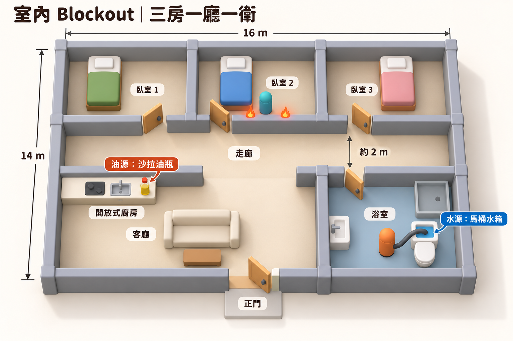
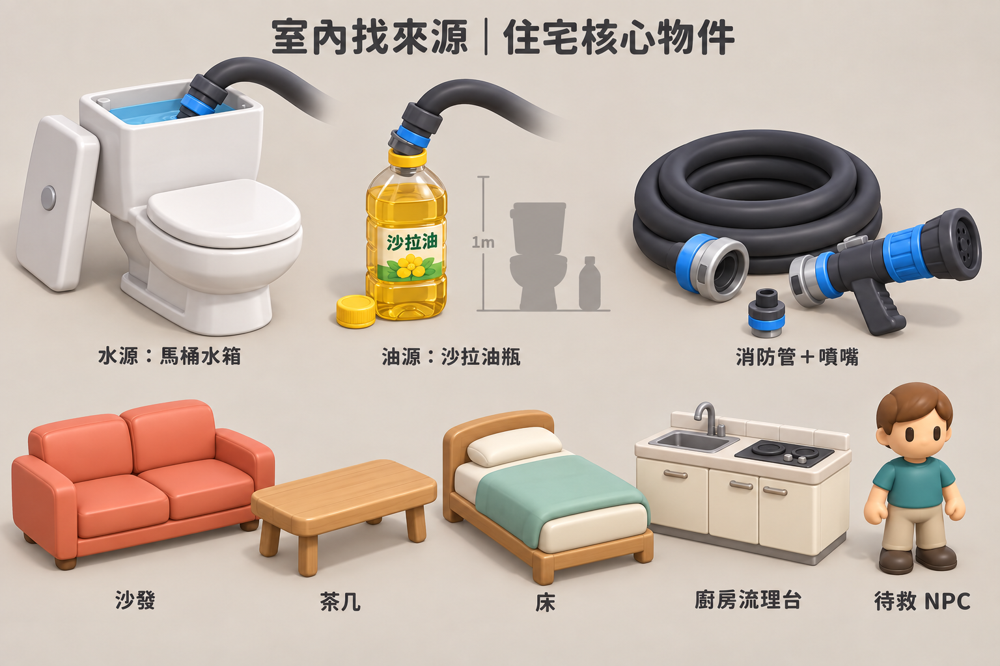
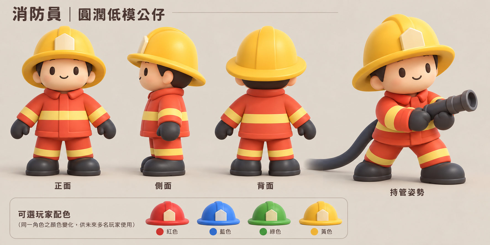

# 消防 Prototype v0.1 — 住宅概念圖第二版

日期：2026-10-04  
狀態：2026-10-05 使用者回覆「開始建模」，已授權依本版製作；實際模型與住宅整合見 [建模交接](../../MODELING_v0.1.md)。以下保留 10-04 的提案內容作為核准依據，不代表目前仍未建模。

## 核心概念（以使用者最新方向為準）

消防隊到場滅火，卻發現消防車沒水，只能拿消防管進住宅尋找日常物品作為來源。第一版仍只有 Water 與 Oil：

- Water：**馬桶後方的水箱**，不是馬桶盆，也不是專用供水桶。
- Oil：**一瓶沙拉油**，放在廚房流理台；不是工業油槽。
- 水負責滅火／推動；油造成滑地、遇火助燃，保留既有元素方向。
- 不再使用工作台、儲物櫃、工業來源桶或倉庫箱作為本輪建模目標。

此方向取代 [第一版審圖](../v0.1/CONCEPT_REVIEW.md) 的單間工作／儲藏室提案，舊圖保留作工作歷史。

## 1. 三房一廳一衛

最新室內圖依使用者「不需要這麼細緻」要求，改用簡單 Blockout：只留牆、開口、床／沙發／茶几等必要家具色塊及來源位置；角色以 Capsule 示意。拿掉植物、床邊桌、衣櫃、裝飾與材質細節。消防員與物件圖不變，且仍未建模。原 [細稿](01-residential-layout.png) 保留作歷史；簡化提示詞見 [PROMPTS-BLOCKOUT.md](PROMPTS-BLOCKOUT.md)。

配置提案：上排三間獨立臥室，各有床與通往走廊的門；中央走廊；前左客廳及小型開放廚房；前右一間浴室；正門由客廳通往屋外。開放廚房包含在客廳生活區，不另增加房間。

水源在浴室馬桶水箱，油源在廚房流理台。初始入口至浴室可通行，NPC 位於臥室 2，圖中少量橘色火點僅為其附近危險區的示意；不讓玩家在找第一個來源之前就被整條火帶封住。

預期救援路線：**NPC 臥室門 → 走廊 → 客廳 → 正門 → 屋外**。玩家先找到水源、拉管清路並安撫 NPC，再讓 NPC 自己逃生；不做搬運 NPC。最終圖移除審圖用逃生箭頭，所有房間名稱與來源註記只供審圖，不代表要放進正常 Game View。

尺寸為遊戲尺度提案：約 16×14 m，走廊淨寬約 2 m；家具不堵門口與走廊。圖仍有立體俯視表現，不是精準施工圖，建模時應以尺寸與動線合約校正。低牆／屋頂開放保留角色可讀性，不使用整面牆消失的表現。室內先以必要家具與空間可讀性為主，不新增裝飾建模清單。

## 2. 日常住宅物件

八組：馬桶與打開的水箱、沙拉油瓶、管線／噴嘴、沙發、茶几、床、廚房流理台、待救 NPC。

- 水箱取水點設在水箱上方；水箱蓋可拆開或放旁邊，馬桶座蓋關閉，視覺上清楚區分水箱與盆。
- 沙拉油是正常廚房小瓶子；圖中的接頭是可拆的遊戲化轉接件，不把瓶子做成常駐工業接管站。
- 圖中油瓶為了審圖放大展示，旁邊比例輪廓提示瓶子應明顯小於馬桶。實際尺寸需於建模校正。
- 家具採圓角、簡單幾何、霧面公仔質感；床可先共用模型，以被單顏色區別三房。
- 住宅正常出現的流理台不是原先的工作台／工業儲物櫃。

## 3. 消防員沿用

沿用黃帽、橘紅制服、寬反光帶與約三頭身的圓潤公仔提案；本輪未重新生成。未宣稱已獲整組建模核准，也未實作四人連線。

## 核准後的下一步

先做消防員、噴嘴、馬桶水箱與沙拉油瓶，再做住宅最少家具、NPC 與低牆三房配置。浴室洗手台／淋浴等以簡單住宅幾何補齊；不加入工業倉庫道具。

實作後需重新驗證：屋內找來源 → 接管 → 跨房間拉管 → 水／油噴射反應 → 清路救援。新地圖需要重新核對現有 13m 管長、火格範圍、家具碰撞與 NPC 路徑；不能把舊單房測試結果當作住宅已通過。來源容量、油瓶是否可搬、管線繞牆等未在本輪新增或定案，不因概念圖而自動擴張系統。

**本輪僅修正圖片與文件，Unity 的現有場景／腳本仍未改動。** 圖稿非 Mesh、未驗證拓樸／骨架／材質效能；未重跑 Unity 編譯、Play Mode 或 Build。

核准紀錄：使用者於 2026-10-05 回覆「開始建模」。內建 imagegen 生成紀錄、完整提示詞與修正過程見 [PROMPTS.md](PROMPTS.md)。
