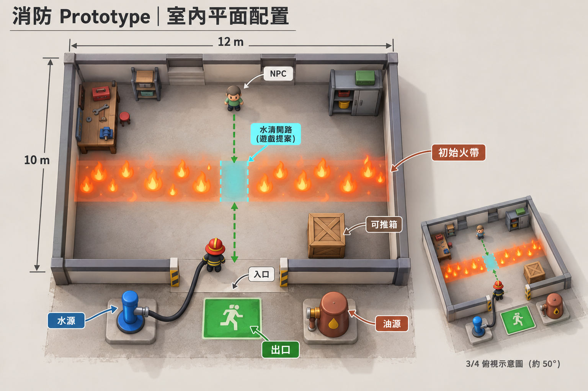
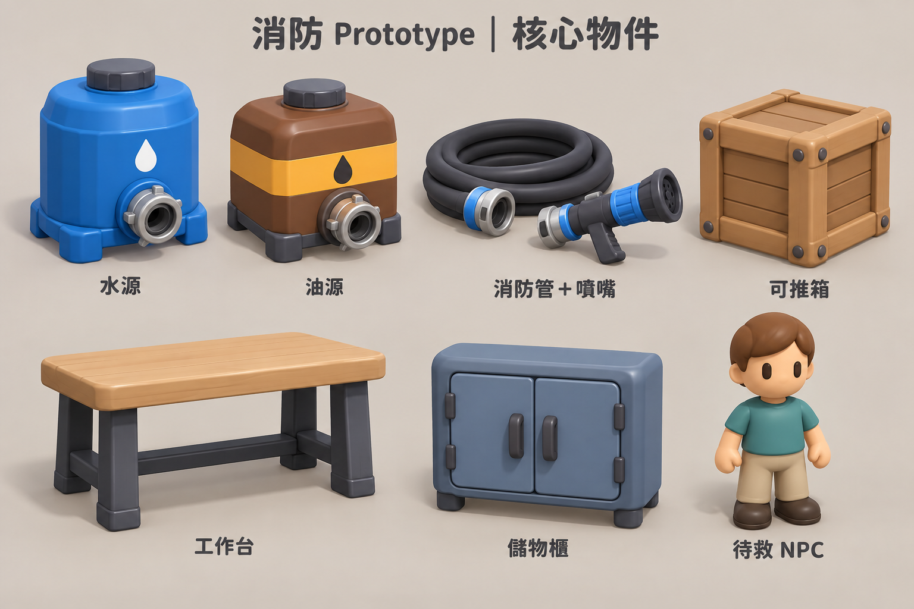

# 消防 Prototype v0.1 — 概念圖審核

日期：2026-10-04  
狀態：**舊版提案，室內配置與來源物件已被住宅第二版取代；尚未建模／尚未整合 Unity。**

最新方向：消防車沒水，進屋找馬桶水箱與沙拉油瓶；完整三房一廳一衛，不使用工業來源桶、工作台與儲物櫃。請以 [住宅第二版審圖](../v0.1-r2/CONCEPT_REVIEW.md) 為準；本文件及圖片保留作歷史，消防員圖暫沿用。

本輪只製作圖稿，不修改既有水／油反應、管線、NPC、輸入或遊戲流程。圖稿存於 Docs，未作為 Unity 資產匯入。

## 1. 室內平面配置

沿用現有約 12×10 公尺的單一工作／儲藏房間，入口朝前庭；左側水源、右側油源、門外出口。後方 NPC、左右固定家具、前右可推箱，中間保留寬通道。

圖中的中央藍色缺口表示「玩家用水清路後」的示意，**不是開局已經安全**。初始火帶應維持擋路；需要安撫 NPC 並清出完整安全路線，NPC 才自己走到出口。虛線只是審圖用路線示意，不是新增遊戲 UI。

這是空間配置概念，主圖仍帶有立體俯視表現；12×10 m 尺寸與至少約 2.5 m 中央淨通道以本文件為準，不以圖片透視比例作施工依據。前景採低牆，牆的碰撞保持完整；不新增整面牆隱藏系統。

## 2. 消防員

黃帽、橘紅制服、寬反光帶、黑手套／靴子；約三頭身、大圓角、簡單臉部、霧面公仔感。提供正面／側面／背面與持管姿勢。

角色外形與服裝以本張為準，平面配置圖中消防員的紅帽僅為位置示意。底部四色是未來玩家辨識配色提案，並不代表本輪已實作四人或連線。

## 3. 核心物件

包含七組：水源、油源、消防管＋噴嘴、可推箱、工作台、儲物櫃、待救 NPC。

- 水源：藍色圓桶；油源：棕色方桶搭配琥珀色帶。除顏色外也用輪廓區分。
- 管線：深色粗管、簡單接頭／噴嘴。後續仍沿用現有簡化管線，不因此改成軟體繩索物理。
- 可推箱保持可推動；工作台與櫃子保持固定障礙。
- NPC 用青綠上衣區別消防員，仍自行逃生，不改成搬運。
- 家具與來源模型外形以本張為準；平面圖的工具、架子與較高櫃體只是氣氛示意，不自動增加建模清單。

## 視覺方向與確認

低模指簡單幾何與可控面數；圓潤由適量倒角與平滑法線達成，不以尖銳切面呈現。圖稿不是現成 Mesh，也未驗證拓樸、骨架、材質或效能。

請確認：
1. 室內配置與寬通道。
2. 消防員比例、黃帽橘紅制服。
3. 水／油桶與七組物件風格。

可以回覆「全部同意」，或按圖號提出修改。**使用者同意後才開始建模。** 預計先做消防員、噴嘴與兩種來源，再做箱子、家具與 NPC，最後進行低牆房間視覺整合；每一步保留現有 Gameplay 合約。

生成方式與完整提示詞見 [PROMPTS.md](PROMPTS.md)。本輪只做圖片視覺檢查與文件／檔案檢查，沒有重新跑 Unity 編譯、Play Mode 或 Build；既有驗證結果保留在工作紀錄，不將它們視為新美術的驗證。
