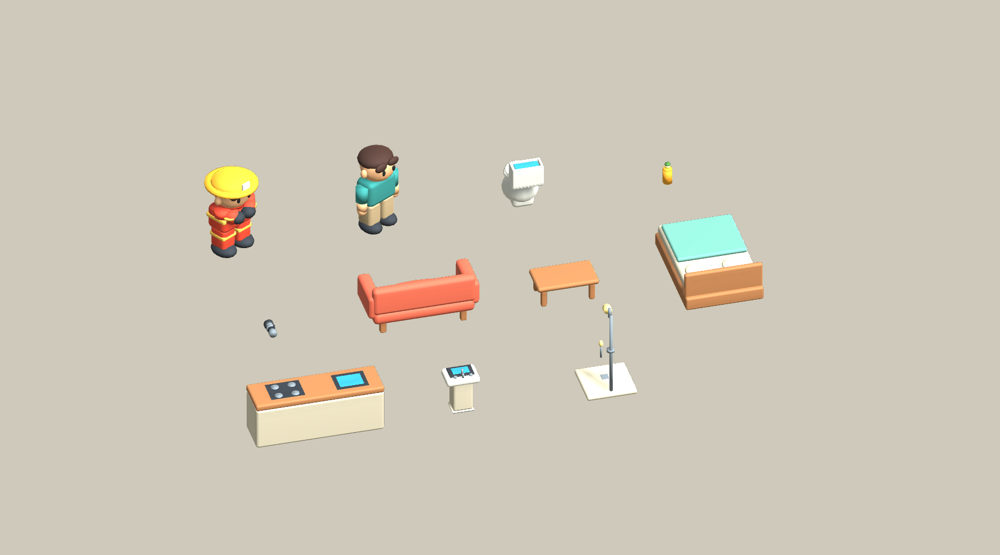
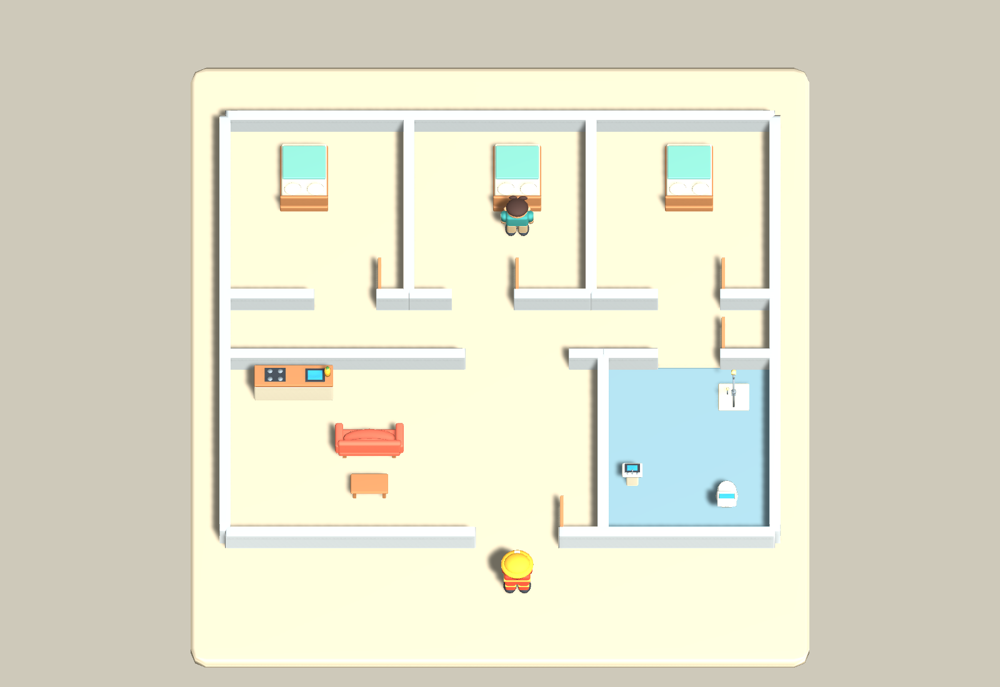

# Fire Rescue v0.1 建模交接

日期：2026-10-05。依使用者「開始建模」授權完成本輪模型與簡單住宅整合。

本文件是住宅初次建模的歷史基準。消防員／居民已重做並加入骨架動畫，最新狀態見 [角色 v0.3 視覺迭代](CHARACTERS_v0.3_REVIEW.md)；以下角色面數、「無骨架」及截圖僅適用於初次建模階段。家具／住宅仍沿用這一版。

來源為 `ArtSource/Tools/build_characters.py`、`build_household.py`、`build_shell.py` 與共用 `model_primitives.py`。可編輯原始檔存於 `ArtSource/Models/*.blend`；Unity 使用 `Assets/FireRescue/Art/Models/*.fbx` 與同名 `Prefabs/`。

## 匯入清單

以下為 `Logs/residential-art-import.txt` 的實際 Unity 匯入值。尺寸是該報告 `bounds extents × 2`，順序為 Unity `(X, Y, Z)`。

| 資產 | 三角數 | 尺寸 (m) |
| --- | ---: | --- |
| Firefighter | 4,296 | 0.94 × 1.60 × 0.94 |
| Resident | 3,312 | 0.96 × 1.60 × 0.68 |
| Toilet | 1,428 | 0.66 × 1.04 × 0.92 |
| SaladOil | 512 | 0.18 × 0.40 × 0.18 |
| Nozzle | 420 | 0.16 × 0.18 × 0.36 |
| Sofa | 1,312 | 2.00 × 0.94 × 0.86 |
| CoffeeTable | 540 | 1.10 × 0.42 × 0.66 |
| Bed | 880 | 1.40 × 0.70 × 2.10 |
| KitchenCounter | 716 | 2.30 × 0.92 × 0.70 |
| Sink | 652 | 0.60 × 0.84 × 0.46 |
| Shower | 724 | 0.90 × 1.74 × 0.90 |
| Block | 108 | 1.00 × 1.00 × 1.00 |

兩個角色皆為 1.6m。沙拉油瓶為小型約 0.39m 設計（Unity 報告高度四捨五入為 0.40m）；馬桶為開放水箱、閉合馬桶蓋的造型。

## 座標與限制

Blender authoring 為 Z-up，Unity 為 Y-up。FBX 匯入後，地板／牆若需非均勻縮放，請以外層零旋轉 wrapper 承擔 Unity 軸向縮放，保留 FBX 模型根節點的座標轉換旋轉，不將其重設為 identity。

資產為平色霧面材質；無骨架、動畫、UV 細節貼圖。消防噴嘴是獨立資產，不烘入消防員。

## 重建

在專案根目錄以 Blender 5.1 執行：

```powershell
& 'C:\Program Files\Blender Foundation\Blender 5.1\blender.exe' --background --python 'ArtSource\Tools\build_characters.py'
& 'C:\Program Files\Blender Foundation\Blender 5.1\blender.exe' --background --python 'ArtSource\Tools\build_household.py'
& 'C:\Program Files\Blender Foundation\Blender 5.1\blender.exe' --background --python 'ArtSource\Tools\build_shell.py'
```

Unity 中使用「`消防 Prototype/建置住宅與模型（覆寫住宅場景）`」會覆寫 `Assets/FireRescue/Scenes/ResidentialFire.unity`；既有 `FireRoom.unity` 會保留，不會被此建置器覆寫。

## 實際預覽與驗證

這些是 Unity 實際 Mesh 渲染，不是概念圖：





- Unity 6000.5.0b9 匯入／編譯／住宅建置通過，`RESIDENTIAL_SETUP_PASS`，exit code 0。
- 住宅 Play Mode **40 項通過**，`RESIDENTIAL_PLAYMODE_PASS`，exit code 0。用真實 CharacterController 經門進浴室接水、13m 拉管、安撫與噴水清路，在 FireField／NPC Update 運作時讓居民經臥室門、走廊、客廳抵達正門外。
- 包含水推茶几／玩家、牆後噴流負例、換接沙拉油、實際落地與滑動；元素助燃／滅火另有隔離測試。水推測試直接呼叫反應入口，不宣稱額外測過瞄準茶几的實體滑鼠輸入。
- 建模整合當時，FireRoom／meta 未覆寫，FireField、ElementReaction、FirefighterMotor、SprayEmitter、HoseConnection 與建模前 SHA256 相同。後續 10-05 操控調整有修改 Motor／Input／HoseConnection／SprayEmitter／NPC 安撫遮擋；此處是建模階段證據，最新狀態見 `Docs/WORKLOG.md`。
- 原始證據：`Logs/residential-setup.log`、`residential-smoke.log`、`residential-playmode-results.txt`、`residential-art-import.txt`；驗證報告副本在 [此處](Models/v0.1/playmode-results.txt)。

未測實體鍵鼠手感、獨立 Windows Player build、四人連線；無正式動畫／UI。管線只呈現鬆弛與距離限制，可能穿牆；噴流仍有碰撞阻擋。來源維持無限，未做水箱容量或搬油瓶。
