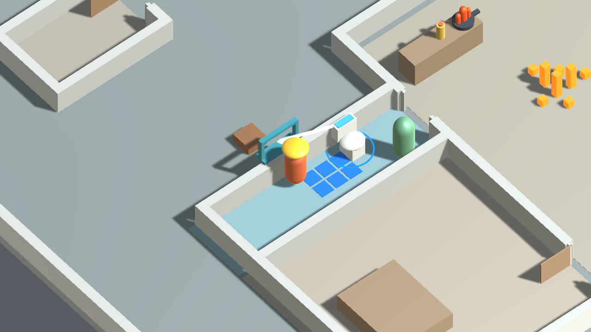

# 消防車沒水了 v0.1

消防隊抵達火場，消防車卻沒水了！玩家只能帶著消防管進入住宅，尋找能接上的日常物品，破門、清除火點並讓居民自行逃出。長期目標是多人合作，**本版先提供單人測試**。

目前版本是可遊玩的住宅關卡 `TutorialGreybox`，以玩法驗證為目的，並非正式美術或完整產品。

## 下載與執行

- Windows 玩家版：到 [v0.1 Prototype 下載頁](https://github.com/brawlstarsshellygod520-hub/--v0.1/releases/tag/v0.1.0-prototype)，下載 **`FireRescue-v0.1-Windows-x64.zip`**。先完整解壓縮，**保留 `FireRescue_Data`、`MonoBleedingEdge` 資料夾與所有 DLL 檔案**，再執行 `FireRescue.exe`；不要直接在壓縮檔內開遊戲。
- GitHub 的 **Source code ZIP 不是可直接執行的遊戲**。若要從原始碼開啟：解壓後以 Unity Hub「Add」選取專案資料夾，使用 Unity **6000.5.0b9** 開啟 `Assets/FireRescue/Scenes/TutorialGreybox.unity`，按 Play。
- Unity Editor 中可停止後再次 Play 重置本局；Windows 版請關閉 `FireRescue.exe` 後重新開啟（Alt+F4 可關閉）。現階段沒有主選單或重開按鈕。



## 操作

| 操作 | 功能 |
| --- | --- |
| WASD | 依螢幕方向移動 |
| 滑鼠 | 瞄準 |
| 左鍵 | 第一下裝備斧頭；之後點按揮一刀，按住可連續揮砍 |
| 右鍵 | 第一下裝備噴槍；靠近來源再按一次接上；之後點按／按住噴射 |
| F | 在來源旁接管、改接或拔管；在較近的窗口旁固定／解除窗口路由 |

不使用 E 鍵。居民不需安撫；安全路徑出現後會自行前往出口，玩家請避免堵住門口。

## 建議遊玩流程

1. 從正門進屋，到左側浴室；裝備斧頭後對浴室門砍三刀，打開通路。
2. 靠近馬桶水箱，先裝備噴槍再接水。水可處理一般地板火。
3. 清出浴室逃生路線，居民會自行離開。
4. 靠近北側青色窗框按 F 固定白管，從窗口滅掉室外木塊火；再按 F 解除窗口路由。
5. 回到浴室門口，先用水清除主室的地板火。油鍋火無法用水撲滅；回水箱旁按 F 拔管，再到主室北側紅色家用乾粉來源接管，以乾粉持續噴射滅火。
6. 居民成功逃出，且地板火、窗外物件火與油鍋火都熄滅時，本局完成；目前不顯示過關 UI。

## 關卡規則與內容

- 水、沙拉油、家用乾粉為三種元素來源；水對油鍋火無效，應改用乾粉。
- 水可熄滅一般火並推動可移動物件；油讓地面變滑，遇火會助燃。地板火會緩慢蔓延。
- 斧頭需 3 次有效命中才能破壞浴室門。
- 水管最大長度為 **3m**；噴槍射程為 **6.5m**。窗口固定路線約 **2.87m**，與噴射距離是不同限制。
- NPC 依安全路徑自動逃生；救援成功與所有火熄滅會分別計算。

## 專案結構

```text
Assets/FireRescue/
  Scenes/        TutorialGreybox.unity（目前關卡）
  Runtime/
    Player/      移動、輸入與鏡頭
    Hose/        管線連接、噴射與路由呈現
    Source/      水、油、乾粉來源
    Fire/         地板與物件火勢
    Interaction/  斧頭受擊、門耐久與破壞呈現
    NPC/          自主逃生
    Game/         關卡狀態與完成條件
  Editor/        關卡安裝、驗證與 Windows 建置工具
Docs/            遊玩流程、技術說明與驗證紀錄
```

## 目前限制

- 單人本機遊玩，沒有連線或多人模式。
- 場景和物件以灰盒／基礎幾何為主，尚非正式美術。
- 消防管沒有完整碰撞或自動繞障礙；在其他牆角可能穿過場景。
- 沒有主選單、教學 UI、過關 UI、音效、存檔、氣體／通風、火傷或復活系統。
- 這是遊戲原型規則，並非現實消防操作教學。

## 驗證狀態

目前已記錄 **64 項 PlayMode 檢查**通過；Windows x64 Mono Development 建置完成，記錄為 **0 errors / 0 warnings**。實體鍵盤與滑鼠的人工遊玩測試尚未完成（曾被 Escape 中斷），因此不將其宣稱為已驗收。

- [住宅整關流程與操作](Docs/RESIDENTIAL_PLAYABLE_LOOP.md)
- [整合 PlayMode 驗證紀錄](Docs/Validation/2026-10-25-residential-integration/playmode.txt)
- [Windows 建置紀錄](Docs/Validation/2026-10-25-residential-integration/build.txt)
- [破門與路線驗證紀錄](Docs/Validation/2026-10-25-breakable-door/playmode.txt)
- [驗收總結與尚未完成項目](Docs/Validation/2026-10-25-residential-integration/RESULT.md)
- [畢業專題工作紀錄](Docs/WORKLOG.md)
